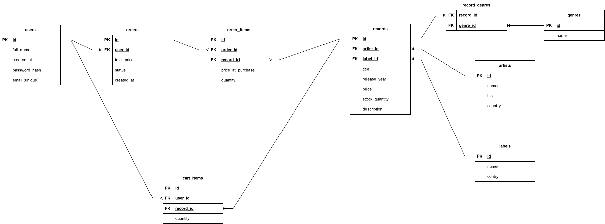

# vinyl-vault

`vinyl-vault` is a site which needs to simulate the work of a real vinyl shop. It will allow users to look through the available records, artists, labels, also narrow their search with filters, take options from catalogue to their shopping cart and order them.

## Endpoints

### `/records`

* GET `api/v1/records`
  * Usage: get list of records with filters.
  * Query parameteres: `search`, `genre_id`, `label_id`, `page`, `limit`.
  * Reponse status: `200 OK`
  * Response body:
  
  ```json
  {
    "data": [
        {
            "id": 10,
            "title": "The Dark Side of the Moon",
            "artist_name": "Pink Floyd",
            "price": 1450.00,
            "release_year": 1973
        }
    ],
    "pagination": {
      "total": 1,
      "page": 1
    }
  }
  ```

* GET `api/v1/records/<id>`
  * Usage: get full information about one record.
  * Response status: `200 OK`
  * Response body:

  ```json
  {
    "id": 10,
    "title": "The Dark Side of the Moon",
    "artist": { "id": 4, "name": "Pink Floyd" },
    "label": {"id": 2, "name": "Harvest Records" },
    "genres": [{ "id": 1, "name": "Progressive Rock" }],
    "release_year": 1973,
    "price": 1450.00,
    "stock_quantity": 5,
    "description": "Classical eighth studio album of the band."
  }
  ```

* POST `api/v1/records`
  * Usage: adding new record to the catalogue.
  * Response status: `201 Created`
  * Request body:

  ```json
  {
    "title": "Abbey Road",
    "artist_id": 1,
    "label_id": 3,
    "genre_ids": [1],
    "release_year": 1969,
    "price": 35.00,
    "stock_quantity": 3,
    "description": "Twelveth album of the Beatles"
  }
  ```

  * Response body:

  ```json
  {
    "id": 2,
    "title": "Abbey Road",
    "artist_id": 3,
    "label_id": 4,
    "release_year": 1969,
    "price": 1300.00,
    "stock_quantity": 10
  }
  ```

* PUT `api/v1/records/<id>`
  * Usage: updating record data.
  * Response status: `200 OK`
  * Request body:

  ```json
  {
    "title": "Abbey Road (Remastered)",
    "artist_id": 3,
    "label)id": 4,
    "genre_ids": [1],
    "release_year": 1500.00,
    "stock_quantity": 8,
    "description": "Updated tdition with enhanced audio"
  }
  ```

  * Response body: fully updated object.

* DELETE `api/v1/records/<id>`
  * Usage: deleting record from the catalogue.
  * Response status: `204 No Content`

### `/artists`

* GET `api/v1/artists`
  * Usage: get list of artists.
  * Response status: `200 OK`
  * Response body:

  ```json
  [
    {
      "id": 5,
      "name": "Pink Floyd",
      "country": "Great Britan"
    },
    {
      "id": 3,
      "name": "The Beatles",
      "country": "Great Britan"
    }
  ]
  ```

* GET `api/v1/artists<id>`
  * Usage: get full information about one artist.
  * Response status: `200 OK`
  * Response body:

  ```json
  {
    "id": 5,
    "name": "Pink Floyd",
    "country": "Great Britan",
    "bio": "British progressive rock band founded in 1965 in London"
  }
  ```

* GET `api/v1/artists<id>/records`
  * Response status: `200 OK`
  * Response body:

    ```json
    [
      {
        "id": 1,
        "title": "The Dark Side of the Moon",
        "release_year": 1973,
        "price": 1450.00
      },
      {
        "id": 7,
        "title": "The Wall",
        "release_year": 1979,
        "price": 1600.00
      }
    ]
    ```

* POST `api/v1/artists`
  * Usage: adding new artist to data base.
  * response status: `201 Created`
  * Request body:

  ```json
  {
    "name": "Daft Punk",
    "country": "France",
    "bio": "French electro duet"
  }
  ```

  * Response body: created artist object.

* PUT `api/v1/artists/<id>`
  * Usage: updating artist data.
  * Respnse status: `200 OK`
  * Request body: object with the new data.
  * Response body: fully updated object.

* DELETE `api/v1/artists/<id>`
  * Usage: deleting artist from data base.
  * Response status: `204 No Content`

### `/labels`

* GET `api/v1/labels`
  * Usage: get list of labels.
  * Response status: `200 OK`
  * Response body:

  ```json
  [
    {
      "id": 2,
      "nmae": "Harvest Records",
      "country": "Great Britan"
    }
  ]
  ```

* POST `api/v1/labels`
* PUT `api/v1/labels/<id>`
* DELETE `api/v1/labels/<id>`

### `/genres`

* GET `api/v1/genres`
  * Response status: `200 OK`
  * Response body:

  ```json
  [
    { "id": 1, "name": "Progressive Rock" },
    { "id": 1, "name": "Progressive Rock" },
    { "id": 1, "name": "Progressive Rock" }
  ]
  ```

### TODO

`/auth`, `/users`, `/cart`, `/orders`

## Data base

An image bellow shows the schema of data base.


